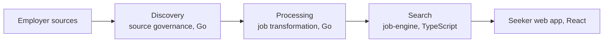

# Swaraj Chandra Reddy M

**Software Engineer at [Dexaminds](https://dexaminds.com/)** · Backend · Full-Stack · Applied AI · Hyderabad, India

[Portfolio](https://swarajreddy10.github.io/) · [Résumé (PDF)](https://swarajreddy10.github.io/Swarajreddy_Software_Engineer.pdf) · [LinkedIn](https://linkedin.com/in/swarajreddy) · [Email](mailto:swarajchandra22@gmail.com) · [Medium](https://medium.com/@swaraj.c)

Hello, I'm Swaraj. I build backend systems that stay correct and fast on real data: Go services, PostgreSQL, and scheduled AWS pipelines, with React on top. At Dexaminds I started and own the two Go services behind SpotMyJob's job-data pipeline, and I measure before I change anything: proving a slow stage was waiting on round trips, not the database, let me raise its throughput 64%.

I work with Claude, Codex, and Cursor every day; nothing ships until tests, benchmarks, and runtime metrics agree.

I'm open to backend, full-stack, platform, and applied AI roles, remote, hybrid, or on-site. If you are hiring, want a second look at a design, or just want to say hello, write to [swarajchandra22@gmail.com](mailto:swarajchandra22@gmail.com) or message me on LinkedIn.

## Work at Dexaminds

Software Engineer, Sep 2025 to present, after a Software Engineer internship from Jun to Sep 2025.

### SpotMyJob: job intelligence and matching platform

SpotMyJob turns jobs from governed employer sources into one canonical record per posting and serves them to job seekers. Its job-data pipeline has three stages, and each service keeps its own database behind versioned contracts, so a new source adapter ships without a change in search.

I started and own the two Go services, discovery and processing. I am a core contributor to the TypeScript search service and the React web app, across ingestion, location, skills, ranking, and search.

- **64%** higher transformation throughput with no new infrastructure. Peak database CPU fell from **99.7%** to **65%** at the same time, which confirmed the stage had been waiting on round trips.
- **17x** faster vector feed ingestion, from about 238 to 13.7 seconds per page on QA. I found a full-precision index no query read but every write still paid for, moved HNSW to a half-precision index, and kept **98.2%** recall@10 against **98.3%**.
- **43%** fewer recurring external fetches by reading only the boards that could have changed. A missing or stale change signal falls back to an alarmed full sweep.
- Ranked matching went from **728 ms** to **68 ms** p50, and now scores every eligible job instead of the top 200, measured on a local copy of QA data.
- A postal reference load projected at **30.2 minutes** finished in **2 minutes 34 seconds** with PostgreSQL `COPY` and one set-based merge.

SpotMyJob design notes

- Matching is one keyset-paged SQL score over every job that passes the seeker's pick and filters. Keyword search reads a GIN-indexed whole-word column with catalog-aware matching, so it never falls back to a full-table scan.
- The feed is replay-safe: durable cursors, idempotent upserts, tombstones, and a complete-set reconciliation that removes any job the producer no longer serves. I wrote that cleanup as a hash anti-join, so it stays fast in every query-plan mode.
- Job and seeker text share one versioned vector space in pgvector. I built the embedding client for Cloudflare Workers AI: Qwen3 vectors, 1,024 dimensions checked on every response, and jittered retries on transient errors only.
- Outbound ingestion validates every address at dial time across IPv4, IPv6, and NAT64, which closes SSRF and DNS rebinding. It also caps response size, locks redirects to the origin, paces requests, isolates a failing source family, and raises a CloudWatch alarm.
- AWS delivery is ECS, RDS PostgreSQL, S3, EventBridge Scheduler, SQS with dead-letter queues, Service Connect, CloudWatch, Terraform, Docker, and GitHub Actions with OIDC. All 81 third-party Actions references are pinned to commit SHAs, with a CI guard that keeps them pinned.
- On the React side: "Did you mean" search that suggests and never auto-applies, draft-then-apply filters, onboarding gated on the answers a match needs, match-score display, and a location picker, each shipped with its Fastify API.

### Osulo: patient-care document intelligence

From April to June 2026 I built Osulo's two Go services: document ingestion, and the Clinical Document Intelligence Service that turned prescriptions and laboratory reports into structured clinical fields.

- Files uploaded straight to S3 through signed POST policies, then passed quarantine, GuardDuty malware scanning, promotion to a trusted bucket, and image normalization before EventBridge and SQS handed them to extraction.
- Extraction ran as a Step Functions workflow over page chunks. Vertex AI Gemini, Azure OpenAI GPT, and Amazon Bedrock sat behind one provider-neutral gate that checked structure, schema, and a 0.85 confidence bar, and sent uncertain fields to human review.
- A multi-page lab report ran from upload to structured result in **62 s**, with extraction at a **10.6 s** p50 (**15.2 s** p95) and a **0.2 s** handoff between services.
- Both services deployed independently through versioned events, idempotent requests, an event outbox, and SQS dead-letter recovery, on PostgreSQL, Terraform, Docker, and GitHub Actions.

### Internship

Reusable React and TypeScript components with lazy loading and code splitting, shipped across the UI-to-API layer, plus **15+** frontend and backend production fixes traced with Chrome DevTools and server logs.

## Personal projects

**[ResumeCanvas](https://www.resumecanvas.live/)**, an AI resume builder you can click through. Next.js 16, React 19, TypeScript, MongoDB, and Puppeteer. Coverage is **95.2%** across 129 tests and 220 assertions. Cached responses stay under **100 ms**, and 7 indexes cut query load by **60%**. Eight AI features call Groq's Llama 3.3 70B, including ATS scoring, keyword analysis, cover-letter generation, and job matching, with 5 templates, PDF export, and public sharing. [ResumeCanvas source code](https://github.com/swarajreddy10/Resume_Canvas).

**[Portfolio site](https://swarajreddy10.github.io/)**, built with Next.js 16 and React 19. Lighthouse scores 100 on accessibility, best practices, and SEO, and 99 on desktop performance, and axe-core reports zero automated violations. [Portfolio source code](https://github.com/swarajreddy10/swarajreddy10.github.io).

## Writing

- [Why Enterprise AI Is Moving From Chat Interfaces to Workspaces](https://medium.com/dexaminds/why-enterprise-ai-is-moving-from-chat-interfaces-to-workspaces-a681c8556fa6), June 2026
- [Why JavaScript Runtimes Are Being Rethought: From Node.js to Bun](https://medium.com/dexaminds/why-javascript-runtimes-are-being-rethought-from-node-js-to-bun-1d2f6bdcc9f7), January 2026

## How I work

I write down the alternative, the constraint, and how we will know the change worked. Concurrency and batch size come from a measurement when CPU, memory, or the connection pool is already the limit. A failure stays visible. The same habit covers APIs, workers, queues, databases, and the AWS path, using logs, query plans, CloudWatch, and execution history.

I use Claude, Codex, and Cursor for research, options, debugging, and review, and I set up Claude Code for both Go services with project rules and hooks that block a commit until its checks pass. I still make the call. A change ships on the primary documentation, the tests, the benchmark, peer review, and what CloudWatch or the execution history recorded.

## Technical skills

<picture>
  <source media="(prefers-color-scheme: dark)" srcset="https://skillicons.dev/icons?i=go%2Cts%2Creact%2Cnextjs%2Cpython%2Cpostgres%2Cmongodb%2Caws%2Cdocker%2Cterraform%2Cgithubactions&theme=dark">
  
</picture>

- **Languages:** Go, TypeScript, SQL, Python
- **Backend and data:** REST APIs, Fastify, PostgreSQL, pgvector, MongoDB
- **Cloud and delivery:** AWS (ECS, RDS, S3, EventBridge, SQS, Step Functions, CloudWatch), Terraform, Docker, GitHub Actions
- **Frontend:** React, Next.js, TanStack Query, React Router, Tailwind CSS, Vite
- **Testing:** unit, integration, and contract tests; Go race tests; Vitest with Testing Library

## Education and certifications

**GITAM University**, B.Tech in Computer Science, Aug 2021 to Jun 2025, CGPA 8.2/10.

- [IBM Full Stack Software Developer](https://www.credly.com/badges/e83c9a88-fb50-4984-a905-68217cc76d9f/public_url), Coursera, Jan 2025
- [AWS Cloud Foundations and Cloud Architecting](https://www.credly.com/badges/43e4a6d2-618f-4003-8a97-f6a773be09d5/public_url), AWS Academy, 2024
- [MongoDB Python Developer Path](https://ti-user-certificates.s3.amazonaws.com/ae62dcd7-abdc-4e90-a570-83eccba49043/2fef1e9a-2ef7-45ea-bdf7-9fde67df65a8-swaraj-chandra-reddy-m-2b64be3a-1a61-4210-9354-4051d4ad0677-certificate.pdf), MongoDB University, Nov 2025
