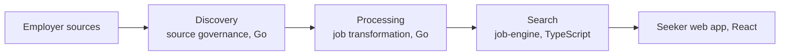

# Swaraj Chandra Reddy M

**Software Engineer at [Dexaminds](https://dexaminds.com/)** · Backend · Full-Stack · Applied AI · Hyderabad, India

[Portfolio](https://swarajreddy10.github.io/) · [Résumé (PDF)](https://swarajreddy10.github.io/Swarajreddy_Software_Engineer.pdf) · [LinkedIn](https://linkedin.com/in/swarajreddy) · [Email](mailto:swarajchandra22@gmail.com) · [Medium](https://medium.com/@swaraj.c)

Hello, I'm Swaraj. I build backend systems that stay correct and fast on real data: Go services, PostgreSQL, and scheduled AWS pipelines, with React on top. At Dexaminds I started and own the two Go services behind SpotMyJob's job-data pipeline, and I size changes on measurement, not assumption: re-sizing a Go stage's concurrency on measured database load raised its throughput 64% with no new infrastructure.

Before I write code, I compare the options against official documentation and the real workload, and I write the decision down. I work with Claude Code, Codex, and Cursor every day; a change merges on passing tests and benchmarks, and I check it against runtime metrics once it is deployed.

I'm open to backend, full-stack, platform, and applied AI roles, remote, hybrid, or on-site. If you are hiring, want a second look at a design, or just want to say hello, write to [swarajchandra22@gmail.com](mailto:swarajchandra22@gmail.com) or message me on LinkedIn.

## Work at Dexaminds

Software Engineer, Sep 2025 to present, after a Software Engineer internship from Jun to Sep 2025.

### SpotMyJob: job intelligence and matching platform

SpotMyJob turns jobs from governed employer sources into one canonical record per posting for job seekers. Its job-data pipeline has three stages, and each service keeps its own database behind versioned contracts, so a new source adapter ships without a contract change in search.

I started and own the two Go services, discovery and processing. I am a core contributor to the TypeScript search service and the React web app, across ingestion, location, skills, ranking, and search.

- **64%** higher transformation throughput with no new infrastructure. I re-sized the worker count on measured load instead of an assumed CPU count, and peak database CPU fell from **99.7%** to **65%** as throughput rose, which showed the stage had been waiting on round trips, not the database.
- **84% to 1.1%** job-board failures in one day. When the first QA sweep lost most boards to 403s, I traced it to a per-IP edge rate limit and shipped pacing the same afternoon; boards that answered rose from **16%** to **98.9%**.
- **17x** faster vector feed ingestion, from about 238 to 13.7 seconds per page on QA. I moved HNSW to a half-precision index (**98.2%** recall@10 against **98.3%**), then dropped the full-precision index every write still maintained.
- **About 40%** fewer Workable board reads per run: boards serving a job are read every run and empty ones rotate every two days, which also removed a third-party feed dependency.
- Ranked matching went from **728 ms** to **68 ms** p50 at its September 2026 release, scoring every eligible job instead of the top 200, measured on a local copy of QA data.
- A postal reference load projected at **30.2 minutes** finished in **2 minutes 34 seconds** with PostgreSQL `COPY` and one set-based merge.

SpotMyJob design notes

- Matching is one keyset-paged SQL score over every job that passes the seeker's pick and filters. Keyword search reads a GIN-indexed whole-word column with catalog-aware matching instead of a `LIKE` scan of every row.
- The feed is replay-safe: durable cursors, idempotent upserts, tombstones, and, per source family, a complete-set reconciliation that removes jobs missing from the producer's served set. I rewrote that cleanup as a hash anti-join after measuring a latent 175-second generic-plan path; under the same forced plan it ran in 162 ms.
- Job and seeker text share one versioned vector space in pgvector. I built the embedding client for Cloudflare Workers AI: Qwen3 vectors, 1,024 dimensions checked on every response, and jittered retries on transient errors only.
- The discovery service validates every address at dial time across IPv4, IPv6, and NAT64, which closes SSRF and DNS rebinding, and it caps response size, paces requests, and isolates a failing source family. The processing service contacts only allowlisted ATS origins, with redirects held to that list and the same per-host pacing.
- AWS delivery is ECS, RDS PostgreSQL, S3, EventBridge Scheduler, SQS with dead-letter queues, Service Connect, CloudWatch, Terraform, Docker, and GitHub Actions with OIDC. The Go services' Actions references are pinned to commit SHAs, with a CI guard that keeps them pinned.
- On the React side: "Did you mean" search that suggests and never auto-applies, draft-then-apply filters, onboarding gated on the answers a match needs, match-score display, and a location picker, each shipped with its Fastify API.

### Osulo: patient-care document intelligence

From April to June 2026 I built Osulo's two Go services: document ingestion, and the Clinical Document Intelligence Service, which classified prescriptions and laboratory reports and extracted structured fields, with schema validation for lab reports. Both ran in a development environment.

- Before the first Go commit, I compared six LLM endpoints on the same documents for cost, latency, and output, replaced an OCR-then-LLM design with a single call that classifies and extracts, and chose the event, workflow, and runtime design against official AWS and vendor documentation.
- Files uploaded straight to S3 through signed POST policies, then passed quarantine, GuardDuty malware scanning, promotion to a trusted bucket, and image normalization before EventBridge and SQS handed them to extraction.
- Extraction ran as a Step Functions workflow over page chunks. I built Gemini API, Vertex AI, Azure OpenAI, and Amazon Bedrock adapters behind one provider-neutral gate that checked structure, the lab-report schema, and a 0.85 classification-confidence bar, and flagged uncertain documents for human review. The development pipeline ran Gemini 2.5 Flash-Lite.
- A multi-page lab report went from malware-cleared file to structured result in **62 s**, with a **0.2 s** handoff between services; the extraction workflow's p50 was **10.6 s** over nine development runs.
- Both services deployed independently through versioned events, idempotent requests, an event outbox in the extraction service, SQS dead-letter queues, and stale-job reconcilers, on PostgreSQL, Terraform, Docker, and GitHub Actions.

### Internship

Reusable React and TypeScript components with lazy loading and code splitting, shipped across the UI-to-API layer, plus **15+** frontend and backend production fixes traced with Chrome DevTools and server logs.

## Personal projects

**[ResumeCanvas](https://www.resumecanvas.live/)**, an AI resume builder you can click through. Next.js 16, React 19, TypeScript, MongoDB, and Puppeteer. AI features on Groq's Llama 3.3 70B cover resume review, keyword analysis, bullet and cover-letter generation, interview questions, and job matching, alongside 5 templates, PDF export, and public sharing. MongoDB has compound indexes on the per-user read paths, and **118** unit and performance tests reach **81.6%** line coverage of the modules under test. [ResumeCanvas source code](https://github.com/swarajreddy10/Resume_Canvas).

**[Portfolio site](https://swarajreddy10.github.io/)**, built with Next.js 16 and React 19. On a local production build in October 2026, Lighthouse scored 100 on accessibility, best practices, and SEO, with performance at 99 on desktop and 84 on mobile, and axe-core reported zero automated violations. [Portfolio source code](https://github.com/swarajreddy10/swarajreddy10.github.io).

## Writing

- [Why Enterprise AI Is Moving From Chat Interfaces to Workspaces](https://medium.com/dexaminds/why-enterprise-ai-is-moving-from-chat-interfaces-to-workspaces-a681c8556fa6), June 2026
- [Why JavaScript Runtimes Are Being Rethought: From Node.js to Bun](https://medium.com/dexaminds/why-javascript-runtimes-are-being-rethought-from-node-js-to-bun-1d2f6bdcc9f7), January 2026

## How I work

- **Research before code, from day one.** SpotMyJob's job-source pipeline started with my research: feasibility, competitor, and data-rights studies consolidated into a proposal covering connector economics, source rights, and operating compliance, which the first Go service then implemented. My decision records cite official documentation with the date it was checked, separates confirmed facts from inference, and names the trigger that must fire before a component is built.
- **Options measured on the real workload.** Ashby became a second job source only after I compared its published fields with Greenhouse on live postings and sized it on a reproducible sample. Skill extraction was chosen over alternatives that included an LLM per job and embeddings, on a benchmark; on QA the share of jobs carrying a skill went from 25.7% to 80.8%.
- **Data overrules the model.** An LLM judge piloted on a held-out labelled set, with rater agreement measured, missed the bar set before the run, so the rules-based path stayed.
- **Fix the cause, keep failures visible.** A feed release that regresses against the last one is refused instead of published, and failed runs raise CloudWatch alarms rather than passing silently. The same habit covers APIs, workers, queues, databases, and the AWS path, using logs, query plans, CloudWatch, and execution history.
- **AI-assisted, human-decided.** I use Claude Code, Codex, and Cursor across research, implementation, debugging, and review, and set up Claude Code for both Go services with project rules and hooks that block a commit until its checks pass. A change merges on the primary documentation, the tests, the benchmark, and peer review; after deploy, I check what CloudWatch recorded.

## Technical skills

<picture>
  <source media="(prefers-color-scheme: dark)" srcset="https://skillicons.dev/icons?i=go%2Cts%2Creact%2Cnextjs%2Cpython%2Cpostgres%2Cmongodb%2Caws%2Cdocker%2Cterraform%2Cgithubactions&theme=dark">
  
</picture>

- **Languages:** Go (Golang), TypeScript, SQL, Python
- **Backend and data:** microservices, REST APIs, event-driven architecture, Node.js with Fastify, PostgreSQL, pgvector, MongoDB
- **AI engineering:** LLM integration (Vertex AI, Azure OpenAI, Amazon Bedrock), Claude Code, Codex, Cursor
- **Cloud and delivery:** AWS (ECS, RDS, S3, EventBridge, SQS, Step Functions, CloudWatch), Terraform, Docker, GitHub Actions
- **Frontend:** React, Next.js, TanStack Query, React Router, Tailwind CSS, Vite
- **Testing:** unit, integration, and contract tests; Go race tests; Vitest with Testing Library

## Education and certifications

**GITAM University**, B.Tech in Computer Science, Aug 2021 to Jun 2025, CGPA 8.2/10.

- [IBM Full Stack Software Developer](https://www.credly.com/badges/e83c9a88-fb50-4984-a905-68217cc76d9f/public_url), Coursera, Jan 2025
- [AWS Academy Graduate: Cloud Architecting](https://www.credly.com/badges/43e4a6d2-618f-4003-8a97-f6a773be09d5/public_url), AWS Academy, May to Jun 2024
- [MongoDB Python Developer Path](https://ti-user-certificates.s3.amazonaws.com/ae62dcd7-abdc-4e90-a570-83eccba49043/2fef1e9a-2ef7-45ea-bdf7-9fde67df65a8-swaraj-chandra-reddy-m-2b64be3a-1a61-4210-9354-4051d4ad0677-certificate.pdf), MongoDB University, Nov 2025
