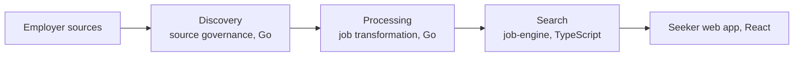

# Swaraj Chandra Reddy M

### Software Engineer at Dexaminds

Backend, search, and applied AI · Hyderabad

[Portfolio](https://swarajreddy10.github.io/) · [LinkedIn](https://www.linkedin.com/in/swarajreddy/) · [Email](mailto:swarajchandra22@gmail.com) · [Writing](https://medium.com/dexaminds)

I'm Swaraj, a software engineer in Hyderabad. I find where a system actually spends its time before I change it, and I want the people on a change to see it, so I talk with them early, write the trade-off where a reviewer can follow it, and stay with the work until production shows what it did.

I'm open to backend, full-stack, platform, and applied AI roles, remote, hybrid, or on-site. Write if you are hiring, if you want a second look at a design, or if you just want to say hello. [Email](mailto:swarajchandra22@gmail.com) or [LinkedIn](https://www.linkedin.com/in/swarajreddy/) is enough.

## SpotMyJob

SpotMyJob turns jobs from governed employer sources into one canonical record per posting and serves them to job seekers. Its job-data pipeline has three stages, and each service keeps its own database behind versioned contracts, so a new source adapter ships without a change in search.

I started and own the two Go services, discovery and processing. I am a core contributor to the TypeScript search service and the React web app, across ingestion, location, skills, ranking, and search. That is over a year in production, after a React and TypeScript internship on the same team.

- **64%** higher transformation throughput with no new infrastructure. I first showed the stage was waiting on round trips, not the database, then raised bounded concurrency; peak database CPU fell from **99.7%** to **65%**.
- **17x** faster vector feed ingestion, from about 238 to 13.7 seconds per page on QA. I found a full-precision index no query read but every write still paid for, moved HNSW to a half-precision index, and kept **98.2%** recall@10 against **98.3%**.
- **43%** fewer recurring external fetches by reading only the boards that could have changed. A missing or stale change signal falls back to an alarmed full sweep.
- Ranked matching went from **728 ms** to **68 ms** p50, and now scores every eligible job instead of the top 200, measured on a local copy of QA data.
- A postal reference load projected at **30.2 minutes** finished in **2 minutes 34 seconds** with PostgreSQL `COPY` and one set-based merge.

Design notes

- Matching is one keyset-paged SQL score over every job that passes the seeker's pick and filters. Keyword search reads a GIN-indexed whole-word column with catalog-aware matching, so it never falls back to a full-table scan.
- The feed is replay-safe: durable cursors, idempotent upserts, tombstones, and a complete-set reconciliation that removes any job the producer no longer serves. I wrote that cleanup as a hash anti-join, so it stays fast in every query-plan mode.
- Job and seeker text share one versioned vector space in pgvector. I built the embedding client for Cloudflare Workers AI: Qwen3 vectors, 1,024 dimensions checked on every response, and jittered retries on transient errors only.
- Outbound ingestion validates every address at dial time across IPv4, IPv6, and NAT64, which closes SSRF and DNS rebinding. It also caps response size, locks redirects to the origin, paces requests, isolates a failing source family, and raises a CloudWatch alarm.
- AWS delivery is ECS, RDS PostgreSQL, S3, EventBridge Scheduler, SQS with dead-letter queues, Service Connect, CloudWatch, Terraform, Docker, and GitHub Actions with OIDC. All 81 third-party Actions references are pinned to commit SHAs, with a CI guard that keeps them pinned.
- On the React side: "Did you mean" search that suggests and never auto-applies, draft-then-apply filters, onboarding gated on the answers a match needs, match-score display, and a location picker, each shipped with its Fastify API.

## Osulo

Healthcare document intelligence. I built the two Go services: document ingestion, and the Clinical Document Intelligence Service that turns prescriptions and laboratory reports into structured clinical fields.

- Files upload straight to S3 through signed POST policies, then pass quarantine, GuardDuty malware scanning, promotion to a trusted bucket, and image normalization before EventBridge and SQS hand them to extraction.
- Extraction is a Step Functions workflow over page chunks. Vertex AI Gemini, Azure OpenAI GPT, and Amazon Bedrock sit behind one provider-neutral gate that checks structure, schema, and a 0.85 confidence bar, and sends uncertain fields to human review.
- A multi-page lab report ran from upload to structured result in **62 s**, with extraction at a **10.6 s** p50 (**15.2 s** p95) and a **0.2 s** handoff between services.
- Both services deploy independently through versioned events, idempotent requests, an event outbox, and SQS dead-letter recovery, on PostgreSQL, Terraform, Docker, and GitHub Actions.

## Public work

**[ResumeCanvas](https://www.resumecanvas.live/)** is the product you can click through. Next.js, React, TypeScript, and MongoDB. Coverage is **95.2%** across 129 tests and 220 assertions. Cached responses stay under **100ms**, and 7 indexes cut query load by **60%**. Eight AI features call Groq's Llama 3.3 70B, including ATS scoring, keyword analysis, cover-letter generation, and job matching, with 5 templates, PDF export, and public sharing. [Source](https://github.com/swarajreddy10/Resume_Canvas).

**[Portfolio](https://swarajreddy10.github.io/)** is Next.js and React. Lighthouse scores 100 on accessibility, best practices, and SEO, and 99 on desktop performance. [Source](https://github.com/swarajreddy10/swarajreddy10.github.io).

**Writing**

- [Why enterprise AI is moving from chat interfaces to workspaces](https://medium.com/dexaminds/why-enterprise-ai-is-moving-from-chat-interfaces-to-workspaces-a681c8556fa6)
- [Why JavaScript runtimes are being rethought, from Node.js to Bun](https://medium.com/dexaminds/why-javascript-runtimes-are-being-rethought-from-node-js-to-bun-1d2f6bdcc9f7)

The internship, from Jun 2025 to Sep 2025, was reusable React and TypeScript UI, plus **15+** frontend and backend production fixes traced with Chrome DevTools and server logs.

## How a change gets to production

I write down the alternative, the constraint, and how we will know the change worked. Concurrency and batch size come from a measurement when CPU, memory, or the connection pool is already the limit. A failure stays visible. The same habit covers APIs, workers, queues, databases, and the AWS path, using logs, query plans, CloudWatch, and execution history.

I work daily with Claude, Codex, and Cursor for research, options, debugging, and review, and I set up Claude Code for both Go services with project rules and hooks that block a commit until its checks pass. I still make the call. A change ships on the primary documentation, the tests, the benchmark, peer review, and what CloudWatch or the execution history recorded.

## Stack

Go · TypeScript · SQL · Python · Fastify · React · Next.js · TanStack Query · Tailwind CSS · PostgreSQL · pgvector · MongoDB · AWS · Terraform · Docker · GitHub Actions

## Background

**GITAM University**, B.Tech in Computer Science, 2021 to 2025, CGPA 8.2/10.

[IBM Full Stack Software Developer](https://www.credly.com/badges/e83c9a88-fb50-4984-a905-68217cc76d9f/public_url) · [AWS Cloud Foundations and Cloud Architecting](https://www.credly.com/badges/43e4a6d2-618f-4003-8a97-f6a773be09d5/public_url) · [MongoDB Python Developer Path](https://ti-user-certificates.s3.amazonaws.com/ae62dcd7-abdc-4e90-a570-83eccba49043/2fef1e9a-2ef7-45ea-bdf7-9fde67df65a8-swaraj-chandra-reddy-m-2b64be3a-1a61-4210-9354-4051d4ad0677-certificate.pdf)
