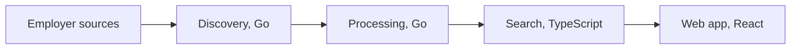

# Swaraj Chandra Reddy M

**Software Engineer at [DexaMinds](https://dexaminds.com/)** · Backend · Full-Stack · Applied AI · Hyderabad, India

[Portfolio](https://swarajreddy10.github.io/) · [Résumé (PDF)](https://swarajreddy10.github.io/Swarajreddy_Software_Engineer.pdf) · [LinkedIn](https://linkedin.com/in/swarajreddy) · [Email](mailto:swarajchandra22@gmail.com) · [Medium](https://medium.com/@swaraj.c)

Hello, I'm Swaraj. I build backend systems in Go, PostgreSQL, and AWS, with React on top. I research before I build and measure before I change, and I work daily with Claude Code, Codex, and Cursor, checking their output with tests and benchmarks.

Open to backend, full-stack, platform, and applied AI roles: remote, hybrid, or on-site. Write to [swarajchandra22@gmail.com](mailto:swarajchandra22@gmail.com).

## Work at DexaMinds

Software Engineer since Sep 2025, after a React and TypeScript internship from Jun to Sep 2025.

### SpotMyJob: job intelligence and matching platform

I started and own the two Go services of its three-stage job-data pipeline, and contribute core search, matching, and React features to the TypeScript search service.

- **64%** higher throughput with no new infrastructure: I re-sized a stage on measured database load, and peak database CPU fell from 99.7% to 65%.
- **88%** fewer requests per job-board sweep: I proved, field by field, that a list endpoint already returned the data per-item calls fetched; ETag revalidation now answers 83% of board reads with 304.
- **17x** faster vector ingestion on QA: a half-precision HNSW index kept 98.2% recall@10, so the full-precision one could go.
- **728 → 68 ms** p50 ranked matching over every eligible job, on a local copy of QA data.

### Healthcare document intelligence (client project, 2026)

Two Go services for a client's healthcare platform: document ingestion and LLM extraction on AWS Step Functions.

- Before the first Go commit, compared LLM providers on the same documents and replaced an OCR-then-LLM design with a single extraction call.
- Built Gemini API, Vertex AI, Azure OpenAI, and Amazon Bedrock adapters behind one validation gate that flagged uncertain documents for human review.
- In development, a multi-page lab report went from malware-cleared file to structured result in **62 s**.

## How I work

- **Research before code.** My decision records cite official documentation with the date checked and separates confirmed facts from inference; SpotMyJob's job-source pipeline began with my sourcing research.
- **Data over the model.** An LLM judge that missed the bar set before its run did not ship; the rules stayed.
- **AI-assisted, human-decided.** Claude Code project rules and hooks in both Go services block a commit until its checks pass.

## Projects and writing

- **[ResumeCanvas](https://resumecanvas.vercel.app/)**: AI resume builder on Next.js 16 and Groq's Llama 3.3 70B, with 5 templates and PDF export; 118 tests at 81.6% line coverage. [ResumeCanvas source](https://github.com/swarajreddy10/Resume_Canvas)
- **[This portfolio](https://swarajreddy10.github.io/)**: Lighthouse 100 for accessibility, best practices, and SEO, and 96 for mobile performance. [Portfolio source](https://github.com/swarajreddy10/swarajreddy10.github.io)
- **Medium:** [Why Enterprise AI Is Moving From Chat Interfaces to Workspaces](https://medium.com/dexaminds/why-enterprise-ai-is-moving-from-chat-interfaces-to-workspaces-a681c8556fa6) · [Why JavaScript Runtimes Are Being Rethought](https://medium.com/dexaminds/why-javascript-runtimes-are-being-rethought-from-node-js-to-bun-1d2f6bdcc9f7)

## Skills

<picture>
  <source media="(prefers-color-scheme: dark)" srcset="https://skillicons.dev/icons?i=go%2Cts%2Creact%2Cnextjs%2Cpython%2Cpostgres%2Cmongodb%2Caws%2Cdocker%2Cterraform%2Cgithubactions&theme=dark">
  
</picture>

Go (Golang) · TypeScript · SQL · Python · Microservices · REST APIs · Event-driven architecture · Node.js · PostgreSQL · pgvector · MongoDB · AWS (ECS, SQS, EventBridge, Step Functions, CloudWatch) · Terraform · Docker · GitHub Actions · LLM integration · React · Next.js

## Education

**GITAM University**, B.Tech in Computer Science, 2021 to 2025, CGPA 8.2/10 · [IBM Full Stack Software Developer](https://www.credly.com/badges/e83c9a88-fb50-4984-a905-68217cc76d9f/public_url) · [AWS Academy Graduate: Cloud Architecting](https://www.credly.com/badges/43e4a6d2-618f-4003-8a97-f6a773be09d5/public_url) · [MongoDB Python Developer Path](https://ti-user-certificates.s3.amazonaws.com/ae62dcd7-abdc-4e90-a570-83eccba49043/2fef1e9a-2ef7-45ea-bdf7-9fde67df65a8-swaraj-chandra-reddy-m-2b64be3a-1a61-4210-9354-4051d4ad0677-certificate.pdf)
