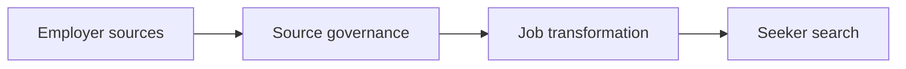

# Swaraj Chandra Reddy M

### Software Engineer at Dexaminds

Hyderabad · Go, TypeScript, PostgreSQL, AWS

[Portfolio](https://swarajreddy10.github.io/) · [LinkedIn](https://www.linkedin.com/in/swarajreddy/) · [Email](mailto:swarajchandra22@gmail.com) · [Writing](https://medium.com/dexaminds)

I build the path from a messy source to one record someone can trust, then to search that still answers when one signal is missing. That work is SpotMyJob: Go services for source governance and job transformation, and a TypeScript search service in front of them.

1+ year in production. The three months before that were a React and TypeScript internship on the same team. Company repositories are private, so this page is the public case study. The projects and essays below are open.

## Work with me

Open to backend, full-stack, platform, and applied AI roles. Remote, hybrid, or on-site.

Useful notes are specific: a service boundary, a ranking change, or a measurement that has to hold while the database is already busy. [Email](mailto:swarajchandra22@gmail.com) or [LinkedIn](https://www.linkedin.com/in/swarajreddy/) is enough.

## SpotMyJob

Employer sources stay governed. Each posting becomes one canonical record. Search reads a versioned feed, and each service keeps its own database, so a new source adapter does not require a change in search.

I am the primary contributor on the two Go backends. I am a major contributor on the TypeScript search service, including ingestion, location, skill, and ranking.

- **64%** higher transformation throughput after raising bounded concurrency from 16 to 20 workers. PostgreSQL CPU and I/O stayed flat or fell.
- **17x** faster vector feed pages, from 238 seconds to 13.7 seconds, with **98.2%** recall@10 against a **98.3%** full-precision baseline.
- A reference load projected at **30.2 minutes** finished in **2 minutes 34 seconds**.
- Recurring external fetches fell **43%**. An invalid or stale change signal still triggers an alarmed full sweep.

Notes for someone who wants the design, not only the numbers

- Hybrid retrieval uses semantic search, PostgreSQL full-text search, structured skill identity, and query relevance, then merges the lists with Reciprocal Rank Fusion. If one path is unavailable, the query continues with the signals that remain.
- Job vectors and seeker vectors share one versioned space. The Qwen3 embedding model runs through Cloudflare's OpenAI-compatible Workers AI gateway, and the vectors sit in pgvector.
- The feed is replay-safe: durable cursors, idempotent upserts, tombstones, and a complete-set reconciliation when a removal event is missed.
- The 17x feed change came from half-precision HNSW: a `halfvec` expression index, plus removal of the redundant full-precision index. Recall stayed at the figures above.
- AWS delivery is ECS, RDS PostgreSQL, S3, EventBridge Scheduler, SQS with a dead-letter queue, Service Connect, CloudWatch, Terraform, Docker, and GitHub Actions with OIDC. Third-party Actions are pinned to commit SHAs.
- Outbound ingestion caps response size, accepts only globally reachable addresses, paces requests, isolates a failing source family, and raises a failure-aware CloudWatch alarm.

## Osulo, completed

Osulo ingested healthcare documents and turned unstructured clinical content into structured fields. I was the primary contributor on two Go services: document ingestion, and clinical-document extraction.

The stages were separate on purpose: secure upload, sanitization, model-assisted extraction, human review, then publication. Vertex AI Gemini and Azure OpenAI GPT mapped sanitized prescriptions and laboratory reports into schema-validated fields, and the source lineage stayed attached for review.

In dev, ingestion took **52 seconds**, extraction took **48 seconds**, and the handoff between the services took **200ms**. End to end, a document took **100.6 seconds**. Fixture-backed contract tests guarded the OpenAPI and event boundary. The path ran on Step Functions, EventBridge, SQS, S3, PostgreSQL, Terraform, Docker, and GitHub Actions.

## Open and worth a look

**[ResumeCanvas](https://www.resumecanvas.live/)** is the product you can click through. Next.js, React, TypeScript, and MongoDB. Coverage is **95.2%** across 129 tests and 220 assertions. Cached responses stay under **100ms**, and 7 indexes cut query load by **60%**. It has 8 AI-assisted features, 5 templates, PDF export, and public sharing. [Source](https://github.com/swarajreddy10/Resume_Canvas).

**[Portfolio](https://swarajreddy10.github.io/)** is Next.js and React. Lighthouse scores 100 on accessibility, best practices, and SEO, and 99 on desktop performance. [Source](https://github.com/swarajreddy10/swarajreddy10.github.io).

**Writing**, when a shift is worth pinning down:

- [Why enterprise AI is moving from chat interfaces to workspaces](https://medium.com/dexaminds/why-enterprise-ai-is-moving-from-chat-interfaces-to-workspaces-a681c8556fa6)
- [Why JavaScript runtimes are being rethought, from Node.js to Bun](https://medium.com/dexaminds/why-javascript-runtimes-are-being-rethought-from-node-js-to-bun-1d2f6bdcc9f7)

The internship, from Jun 2025 to Sep 2025, was reusable React and TypeScript UI, plus **15+** frontend and backend production fixes traced with Chrome DevTools and server logs.

## How a change gets to production

I write the decision down: the alternative, the constraint, and the check that will show whether it worked. Concurrency and batch size come from a measurement when CPU, memory, or the connection pool is already the limit. A failure should stay visible. The same habit covers APIs, workers, queues, databases, and the AWS path, using logs, query plans, CloudWatch, and execution history.

AI shortens the research and the draft. A change still waits on the primary documentation, the tests, the benchmark, peer review, and what production actually recorded.

## Stack

Go · TypeScript · SQL · Python · Fastify · React · Next.js · PostgreSQL · pgvector · MongoDB · AWS · Terraform · Docker · GitHub Actions

## Background

**GITAM University**, B.Tech in Computer Science, 2021 to 2025, CGPA 8.2/10.

[IBM Full Stack Software Developer](https://www.credly.com/badges/e83c9a88-fb50-4984-a905-68217cc76d9f/public_url) · [AWS Cloud Foundations and Cloud Architecting](https://www.credly.com/badges/43e4a6d2-618f-4003-8a97-f6a773be09d5/public_url) · [MongoDB Python Developer Path](https://ti-user-certificates.s3.amazonaws.com/ae62dcd7-abdc-4e90-a570-83eccba49043/2fef1e9a-2ef7-45ea-bdf7-9fde67df65a8-swaraj-chandra-reddy-m-2b64be3a-1a61-4210-9354-4051d4ad0677-certificate.pdf)

